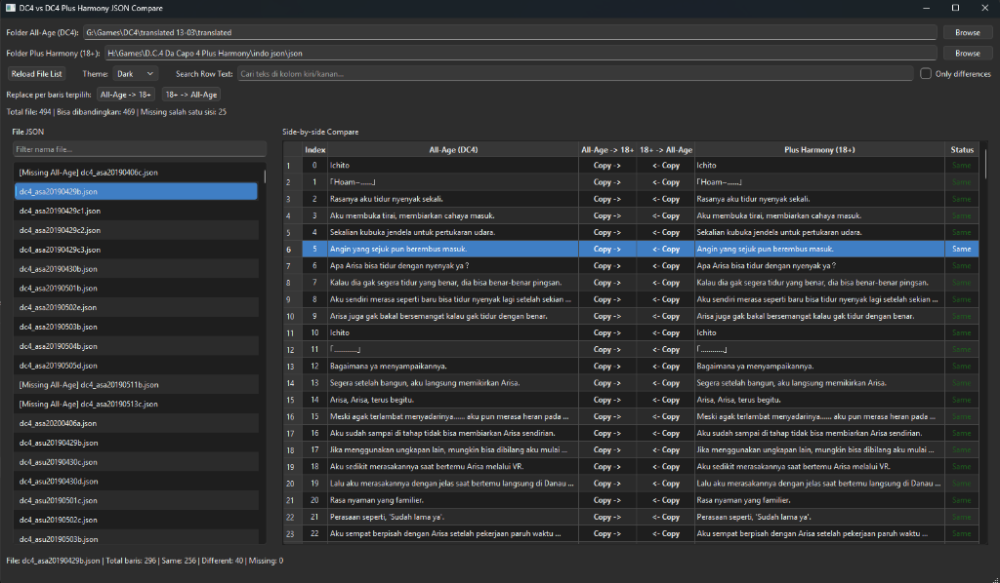
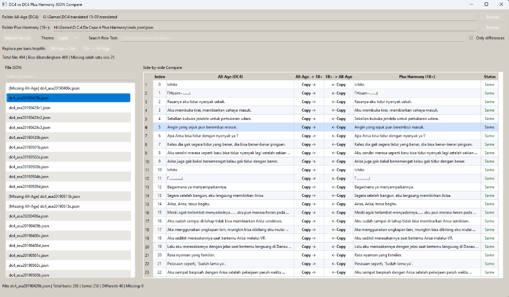

# DC4 vs DC4 Plus Harmony JSON Compare GUI

<div align="center">

  [](https://www.python.org/)
  [](https://www.qt.io/)
  [](LICENSE)
  [](https://microsoft.com/windows)

  <br>

  **Aplikasi desktop GUI canggih berbasis PyQt6 untuk membandingkan (*side-by-side comparison*), menyelaraskan (*synchronize*), dan menyunting naskah terjemahan JSON antara D.C.4 Da Capo 4 (All-Age) dan D.C.4 Plus Harmony (18+) secara instan dan aman.**

</div>

---

## 📸 Antarmuka Aplikasi (Screenshots)

### 🌙 Dark Theme (Mode Gelap)


### ☀️ Light Theme (Mode Terang)


---

## 📑 Daftar Isi
- [Fitur Utama](#-fitur-utama)
- [Struktur Kolom & Status](#-struktur-kolom--status)
- [Pintasan Keyboard (Shortcuts)](#-pintasan-keyboard-shortcuts)
- [Persyaratan Sistem](#-persyaratan-sistem)
- [Instalasi & Menjalankan](#-instalasi--menjalankan)
- [Panduan Penggunaan](#-panduan-penggunaan)
- [Lisensi](#-lisensi)

---

## ✨ Fitur Utama

### 🔍 1. Side-by-Side Comparison Visual
* **Komparasi Sejajar Per Baris**: Menampilkan dialog *All-Age (DC4)* dan *Plus Harmony (18+)* dalam tabel berdampingan dengan penomoran indeks yang presisi.
* **Deteksi Perbedaan Cerdas**: Menyoroti status setiap baris secara visual (`Same`, `Different`, atau `Missing`).
* **Filter `Only differences`**: Menampilkan hanya baris-baris yang berbeda antara kedua versi dalam satu klik centang untuk mempercepat proses peninjauan modifikasi naskah.

### 🔄 2. Transfer & Salin Naskah Dua Arah (Bi-Directional Sync)
* **Salin Per Baris (*1-Click Cell Action*)**:
  * `Copy ->` : Menyalin teks dari versi All-Age ke versi 18+.
  * `<- Copy` : Menyalin teks dari versi 18+ ke versi All-Age.
* **Salin Massal Baris Terpilih**:
  * Tombol `All-Age -> 18+` di header atas.
  * Tombol `18+ -> All-Age` di header atas.
* **Auto-Save & Format Preservation**:
  * Setiap perubahan teks atau transfer baris langsung disimpan secara otomatis ke file JSON asal.
  * Mempertahankan struktur indentasi, spasi ganda, dan karakter khusus Jepang tanpa merusak struktur internal JSON.

### ✏️ 3. Pengeditan Langsung di Tempat (In-Place Editor)
* Klik dua kali atau tekan `F2` pada sel teks untuk mengedit langsung terjemahan.
* Otomatis memperbarui status baris secara *real-time* begitu tombol `Enter` ditekan.

### 🎨 4. Dual Theme (Dark & Light Mode)
* Dilengkapi tema **Dark Mode** modern dan **Light Mode** elegan dengan kontras teks yang nyaman di mata untuk sesi lokalisasi panjang.

### 🔎 5. Mesin Pencarian & Filter Cepat
* **Filter Nama File**: Mencari file JSON tertentu pada daftar skenario di sisi kiri.
* **Pencarian Teks Baris (*Search Row Text*)**: Mencari kata kunci tertentu di kolom kiri (All-Age) maupun kolom kanan (18+) secara langsung.

---

## 📊 Struktur Kolom & Status

| Kolom | Keterangan |
| :--- | :--- |
| **Index** | Nomor urut pesan dialog di dalam file skenario JSON. |
| **All-Age (DC4)** | Teks dialog versi rilis umum (*All-Age*). Dapat diedit langsung. |
| **All-Age -> 18+** | Tombol aksi cepat untuk menyalin teks All-Age ke kolom 18+. |
| **18+ -> All-Age** | Tombol aksi cepat untuk menyalin teks 18+ ke kolom All-Age. |
| **Plus Harmony (18+)** | Teks dialog versi rilis dewasa (*Plus Harmony 18+*). Dapat diedit langsung. |
| **Status** | Indikator status: `Same` (Sama), `Different` (Berbeda), `Missing` (Tidak ada di salah satu sisi). |

---

## ⌨️ Pintasan Keyboard (Shortcuts)

| Shortcut | Aksi |
| :--- | :--- |
| **`Ctrl + Right`** (`Ctrl + →`) | Menyalin baris terpilih dari **All-Age ke 18+** |
| **`Ctrl + Left`** (`Ctrl + ←`) | Menyalin baris terpilih dari **18+ ke All-Age** |
| **`F2`** / **`Double Click`** | Memulai pengeditan teks pada sel terpilih |
| **`Enter`** | Mengonfirmasi edit teks dan menyimpan ke file JSON |
| **`Esc`** | Membatalkan pengeditan yang sedang berlangsung |

---

## 💻 Persyaratan Sistem

* **Sistem Operasi**: Windows 10 / 11 (64-bit)
* **Python**: Versi `3.10` atau lebih baru
* **Library**: `PyQt6 >= 6.4.0`

---

## 🚀 Instalasi & Menjalankan

1. **Clone Repositori**:
   ```powershell
   git clone https://github.com/SakuraSymphonyReTranslation/DC4-vs-DC4PH-JSON-Compare.git
   cd DC4-vs-DC4PH-JSON-Compare
   ```

2. **Pasang Dependensi**:
   ```powershell
   python -m pip install -r requirements.txt
   ```

3. **Jalankan Aplikasi**:
   ```powershell
   python dc4_json_compare_gui.py
   ```
   *Atau jalankan menggunakan Windows Python Launcher:*
   ```powershell
   py dc4_json_compare_gui.py
   ```

---

## 📖 Panduan Penggunaan

1. **Atur Lokasi Folder**:
   * **Folder All-Age (DC4)**: Pilih folder naskah JSON terjemahan versi All-Age (contoh: `G:\Games\DC4\translated 13-03\translated`).
   * **Folder Plus Harmony (18+)**: Pilih folder naskah JSON terjemahan versi Plus Harmony (contoh: `H:\Games\D.C.4 Da Capo 4 Plus Harmony\indo json\json`).
2. **Pilih Skenario**:
   * Klik salah satu nama file di daftar sebelah kiri. File yang hilang di salah satu versi akan ditandai dengan prefix `[Missing ...]`.
3. **Bandingkan & Selaraskan**:
   * Centang `Only differences` jika ingin meninjau perbedaan naskah dengan cepat.
   * Klik tombol `Copy ->` atau gunakan shortcut `Ctrl + Right` untuk menyelaraskan terjemahan.

---

## 🤝 Lisensi

Proyek ini dirilis di bawah lisensi **[MIT License](LICENSE)**.
Dikembangkan khusus untuk komunitas lokalisasi Visual Novel oleh **[Sakura Symphony Re:Translation](https://github.com/SakuraSymphonyReTranslation)**.
